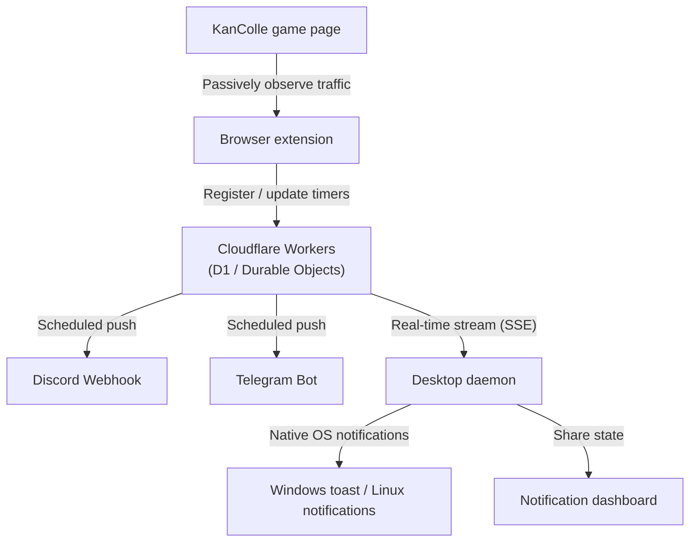

<!-- i18n:overview -->
## Overview

**kancolle-notify** passively reads browser traffic while you play Kantai Collection (KanColle) and provides precise notifications for expeditions, dock repairs, anchorage repairs and fatigue recovery.

Its central server runs on **Cloudflare Workers**, so scheduled push notifications can reach **Discord or Telegram on your phone even after you shut down your PC or close the browser**.
While your PC is running, a lightweight background daemon provides native OS notifications (Windows toast / Linux D-Bus), and a dedicated **notification dashboard** shows remaining times in real time.

<!-- i18n:features -->
## Key features and design

- 🛡️ **Zero additional game traffic**
  - Does not initiate API requests or custom communication with the KanColle servers. It only passively reads the game packets the browser already receives, minimizing the risk associated with additional game traffic.
- ☁️ **Cloudflare Workers integration**
  - Designed to run within the Free plan for personal use. The cloud manages schedules and sends notifications to external services even while your PC is off.
- 🖥️ **Desktop notifications and dashboard**
  - **Background daemon**: Receives server push events and issues Windows toast or Linux D-Bus notifications. Its lightweight design avoids resource-intensive periodic polling.
  - **Notification dashboard**: Shows expedition, dock repair, anchorage repair and fatigue recovery timers for your fleets, updated every second.
- 📱 **Notification destinations**
  - Supports desktop notifications (Windows / Linux), Discord Webhooks and Telegram Bots.

<!-- i18n:timers -->
## Supported timers

| Timer | Monitoring and notifications |
| :--- | :--- |
| **Expeditions** | Calculates and reports return times for fleets 2–4. |
| **Dock repairs** | Tracks the expected completion time for each repair dock. |
| **Anchorage repairs** | Automatically tracks Akashi's 20-minute repair cycles. |
| **Fatigue recovery** | Simulates natural recovery every 3 minutes (up to condition 49) and home-port supply ship recovery (up to condition 54). |
| **Construction** | Reports construction completion times, with an option to hide ship names. |

<!-- i18n:architecture -->
## How it works

The browser extension passively observes game traffic. Cloudflare Workers and the desktop companion cooperate to deliver notifications.



<!-- i18n:installation -->
## Setup

The installer automates Cloudflare Workers provisioning and deployment of the required files.

### 1. Run the installer

#### Windows

1. Download `kancolle-notify-setup.exe` using the download button and run it.
2. Follow the wizard and enter a Cloudflare API token (with Workers / D1 edit permissions) and a notification destination, such as a Discord Webhook.
3. The installer downloads the files and provisions the Cloudflare environment automatically.

#### Linux

**Prerequisites**:
- `curl` and `tar` are required. Install them beforehand if needed, for example with `sudo apt install curl tar`.

**Run the downloaded `install.sh`**:

1. Open a terminal and navigate to your download folder, for example `~/Downloads`.
2. Make the script executable and run it:

```bash
chmod +x install.sh
./install.sh
```

You can also run it directly with `bash install.sh`.

3. Follow the prompts to enter your Cloudflare API token and notification destination.

💡 **Install directly from the terminal**:  
You can also set up the tool using this command:

```bash
curl -fsSL https://raw.githubusercontent.com/Ikumyon/kancolle-notify/main/installer/install.sh | bash
```

📁 **Installation directory**:  
By default, the installer creates a `kancolle-notify` folder in the directory where it was run. It places the daemon and dashboard in `desktop` and the browser extension in `extension`.

### 2. Load the browser extension

1. Open Google Chrome, Microsoft Edge or Damecon.
2. Open the extensions page (`chrome://extensions` in Chrome / `edge://extensions` in Edge).
3. Enable **Developer mode** in the upper-right corner.
4. Click **Load unpacked** and select the generated `kancolle-notify/extension` folder.

The installer has already configured the server connection and authentication settings.

### 3. Start using the tool

- Open the game page, keep Developer Tools (F12) open, and begin playing. Timers are automatically observed and registered.
- Open **艦これ 通知管理** (KanColle Notification Manager) from the desktop shortcut or Start menu to view the current status and remaining times in the dashboard.

<!-- i18n:integration -->
## Integration with other tools

- **[Kancolle Stream Overlay](../../tool.html?tool=kancolle-stream-overlay)**:
  Displays expedition, repair and other timers managed by this tool as overlay panels on your stream or game page.

<!-- i18n:notes -->
## Notes

- This is an unofficial fan-made tool and is not affiliated with DMM GAMES or the KanColle development and operations team.
- A free Cloudflare account and an API token are required.
