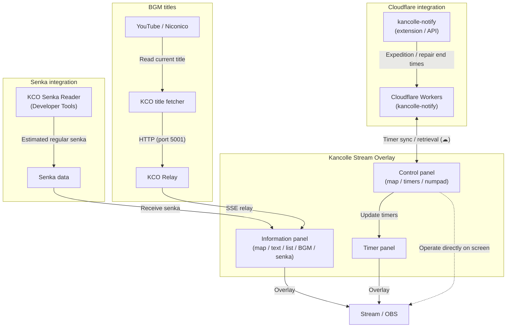

<!-- i18n:overview -->
## Overview

**Kancolle Stream Overlay** is a browser extension (Manifest V3) for KanColle streams. It lets you place timers, sortie maps, run counters, currently playing BGM and senka information over the game screen.

Customize the position, size and appearance of each panel, including frosted-glass effects and transparency, to suit your screen layout and streaming style.

---

<!-- i18n:panels -->
## Three independent panels

Drag and drop each panel to position it anywhere on screen. Use the handle in its lower-right corner to resize it.

### 1. Timer panel (`TIMER`)

Displays real-time countdowns for fatigue recovery, expeditions and dock repairs.

- **Automatic fatigue calculation**: Enter the current and target condition values (for example, 20 → 49) to calculate the recovery time.
- **Home-port supply ship recovery**: Supports the recovery interval and increments for supply ship recovery above condition 49, up to 54.
- **Presets**: Save up to four frequently used durations, such as 10, 20 or 30 minutes, and start a timer with one click.
- **Stacked display**: Shows both the remaining time (`mm:ss`) and expected finish time (`hh:mm`).
- **Display modes**: Choose between always visible and automatically visible only while a timer is running.
- **Click-through background**: Interact with the game behind the timer without hiding it.
- **Desktop notifications**: Receive a browser notification when the timer finishes.
- **Cloudflare integration (kancolle-notify)**: Retrieve running expedition, repair, fatigue and manual timers from the cloud and display them in the timer panel.

### 2. Information panel (`INFORMATION`)

A multi-column panel for organizing stream information. Drag column boundaries to adjust their widths, with ratio snapping. The header and panel background frame can also be hidden.

Combine these **five card types** as needed:

| Card | Features |
| :--- | :--- |
| **Map (`map`)** | Color badges show the sortie map (regular: `7-4`; event: `E-2`), difficulty (甲 / 乙 / 丙 / 丁) and progress (gimmick, chipping, final kill or farming). |
| **Free text (`text`)** | Displays notes and announcements, such as a final-kill attempt or an S-rank target. Long text can move using cyclic shifts or continuous scrolling. |
| **List / counter (`list`)** | Tracks drops and runs. Interactive tags increment or decrement when clicked. |
| **BGM (`BGMtitle`)** | Scrolls the current YouTube / Niconico track title in real time through KCO Relay. |
| **Senka (`senka`)** | Displays estimated regular senka since observation began through KCO Senka Reader. Resets at 02:00 / 14:00 JST. The overlay itself does not monitor game traffic. |

### 3. Control panel (`CONTROL`)

Quickly change map badges and operate timers directly on the stream screen. Hide the panel when it is not needed.

- **Map, difficulty and progress controls**: Toggle event mode (E), enter a map number, and select difficulty (甲 / 乙 / 丙 / 丁 / none) or progress (ギ / 削 / ラ / 掘 / none) with one click.
- **Timer settings and cloud integration**: Enter minutes, use presets, enter fatigue values or stop a timer. The `☁` button retrieves running cloud timers.
- **Pop-up numpad**: Click a numeric field to open a dedicated on-screen keypad for mouse input. Tab navigation and automatic focus movement are also supported.

---

<!-- i18n:counters -->
## List card counter syntax

In addition to comma-separated items, list cards support special syntax for **interactive counters that change when clicked**.

```text
Yamashio Maru:+0/5, Maruyu:+2, Buckets:-10/0, Clear complete
```

| Syntax | Behavior | Example / use |
| :--- | :--- | :--- |
| `Item:+initial/maximum` | Click to **add 1**, up to the maximum. | `Yamashio Maru:+0/5` tracks a drop-farming goal. |
| `Item:+initial` | Click to **add 1**, with no upper limit. | `S ranks:+0` counts runs or S ranks. |
| `Item:-initial/minimum` | Click to **subtract 1**, down to the minimum. | `Buckets:-20/0` tracks remaining resources or attempts. |
| `Item:number` | Displays a fixed number. | `Target:100` records a fixed goal. |
| `Item` | Click to **remove the item**. | `Supply ship quest` works as a checklist entry. |

> [!TIP]
> List card tags also support horizontal scrolling using the mouse wheel or dragging.

---

<!-- i18n:design -->
## Appearance settings

Use the **Design** tab in the extension's settings popup to adjust the appearance with a live preview.

- **Panel scale**: `0.1×` to `2.0×`.
- **Base font size**: `20px` to `60px`.
- **Background color and opacity**: A color picker and a slider from `0%` (transparent) to `100%` (opaque).
- **Frosted-glass effect**: Backdrop blur from `0px` to `20px` creates a translucent background that blends with the game.
- **Shadow spread**: Drop shadows from `0px` to `100px` improve readability.
- **Scroll speed**: Adjust how fast overflowing text moves.
- **Recenter all panels**: Restore panels to the center of the screen with one click if they have been moved out of view.

---

<!-- i18n:integration -->
## Integration with other tools

All display and control features work on their own. Related tools provide additional automation.

- **[kancolle-notify](../../tool.html?tool=kancolle-notify)**:
  - Sends a timer's end time to Cloudflare Workers when it starts.
  - The control panel's `☁` button retrieves running expedition, repair, fatigue and manual timers from the cloud for display in the timer panel.
- **[KCO title fetcher](../../tool.html?tool=kco-title-fetcher)** and **[KCO Relay](../../tool.html?tool=kco-relay)**:
  - Automatically retrieve titles playing on YouTube or Niconico and send them through KCO Relay to the overlay's BGM card in real time using SSE (Server-Sent Events).
- **[KCO Senka Reader](../../tool.html?tool=kco-senka-reader)**:
  - Sends estimated game senka to the senka card in real time. The overlay itself contains no game traffic analysis code.

### Integration diagram



---

<!-- i18n:installation -->
## Setup

1. **Download the extension**:
   - Use the download button to get the latest ZIP file and extract it to a folder of your choice.
2. **Load it in your browser**:
   - Open Chrome or Edge and visit the extensions page (`chrome://extensions` or `edge://extensions`).
   - Enable **Developer mode** in the upper-right corner.
   - Click **Load unpacked** and select the extracted folder containing `manifest.json`.
3. **Configure the extension**:
   - Click its toolbar icon to open the settings popup.
   - **Timer**: Set preset durations and notification preferences.
   - **Information**: Place cards from the layout palette, then set their widths and contents.
   - **Design**: Adjust scale, blur and transparency to suit your stream background.
4. **Use it on the game page**:
   - Open the KanColle game page. Drag the overlay panels to convenient positions.
